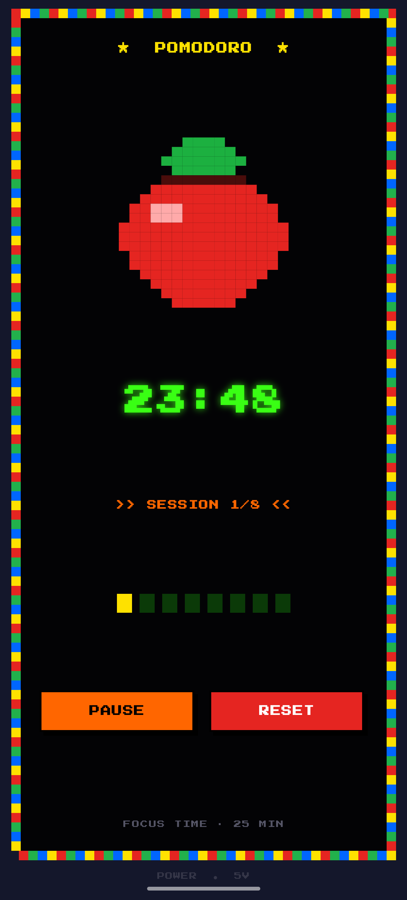
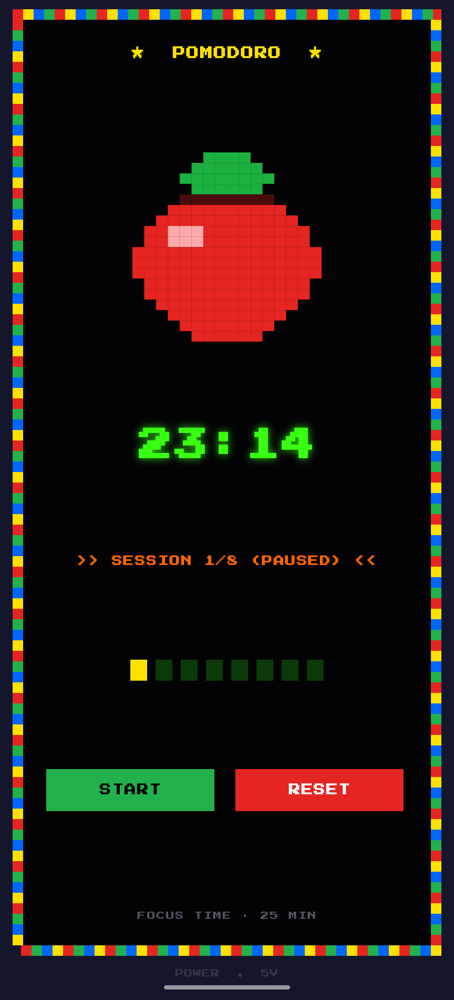
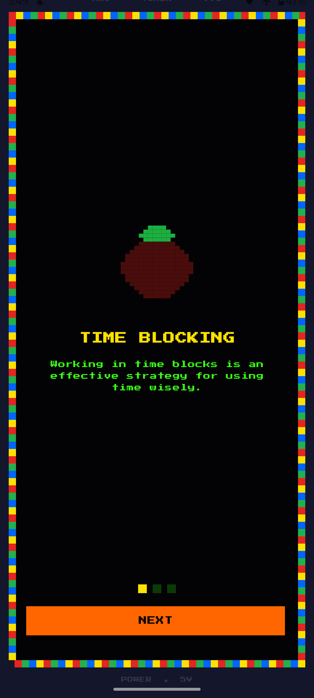

# 🍅 PomoFlow — Native Android Pomodoro & Task Agent

A minimalist, high-precision native Android Pomodoro timer built with Jetpack Compose. Engineered for distraction-free focus sessions, custom vector canvas animations, background resilience, and upcoming local agentic workflows (Obsidian task sync & on-device LLM parsing).

---

## 📱 Screenshots

<p align="center">
  
  &nbsp;&nbsp;&nbsp;&nbsp;
  
  &nbsp;&nbsp;&nbsp;&nbsp;
  
</p>

---

## ✨ Features

- **Interval State Machine:** Standard 25-minute focus intervals, 5-minute short breaks, and automated 60-minute long breaks after 4 cycles.
- **Custom `Canvas` Rendering:** Vector-drawn tomato visual with dynamic liquid-fill progress tracking built purely in Jetpack Compose without static bitmaps.
- **Background Execution:** Native Android `ForegroundService` with ongoing notification controls (Start, Pause, Reset) to guarantee timing precision during process backgrounding and sleep states.
- **Persistent State:** Jetpack DataStore manages user durations and restores countdown states across process death.
- **Theme Support:** Minimalist clean styling with support for dynamic phase color shifts and alternative 8-bit retro arcade themes.

---

## 🤖 Agentic & Notes Integration Roadmap

This project serves as an active testbed for on-device agentic workflows in Android:

- [x] **Core Timer Engine & Background Service**
- [x] **Automated Testing via MCP & Claude Code CLI**
- [ ] **Storage Access Framework (SAF) File Bridge:** Direct read/write access to local Markdown vaults (e.g., Obsidian).
- [ ] **On-Device LLM Task Parser (Gemma / LiteRT):** Extract actionable subtasks and pomodoro estimates from raw unstructured daily notes without cloud dependencies.
- [ ] **Two-Way Status Check:** Automatically mark markdown checkboxes (`- [x]`) upon sprint completion.

---

## 🛠️ Tech Stack & Architecture

- **Language:** Kotlin
- **UI Toolkit:** Jetpack Compose (Material 3)
- **Architecture:** Clean Architecture / MVVM
- **Reactive State:** Kotlin Coroutines & `StateFlow`
- **Dependency Injection:** Hilt
- **Persistence:** Jetpack DataStore (Preferences)
- **Background Services:** Android Foreground Service + NotificationManager
- **Agent Testing:** Anthropic Claude Code CLI via custom Android ADB MCP Server

---

## 🚀 Getting Started

### Prerequisites

- Android Studio Ladybug or newer
- JDK 17+
- Android SDK with API Level 34+
- Physical device or emulator with USB Debugging enabled

### Installation

1. Clone the repository:
   ```bash
   git clone [https://github.com/](https://github.com/)<your-username>/<your-repo-name>.git
   cd <your-repo-name>
